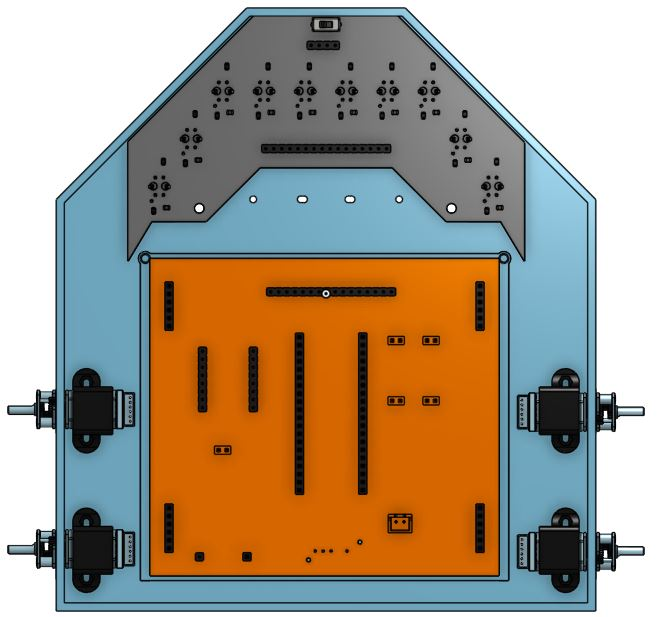
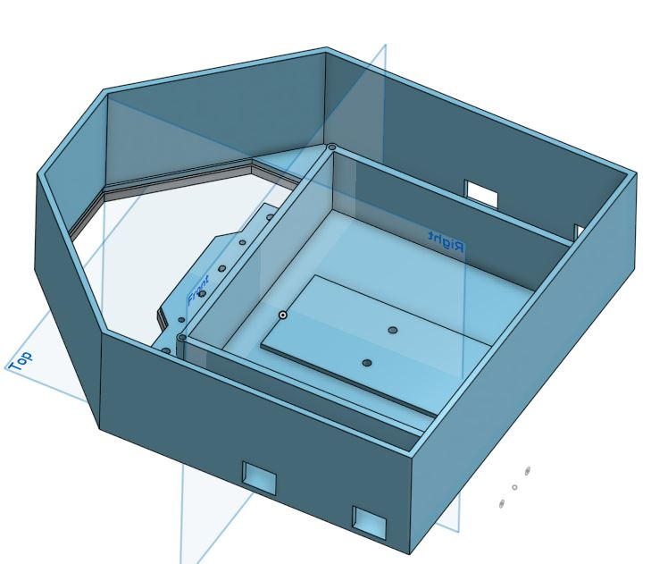
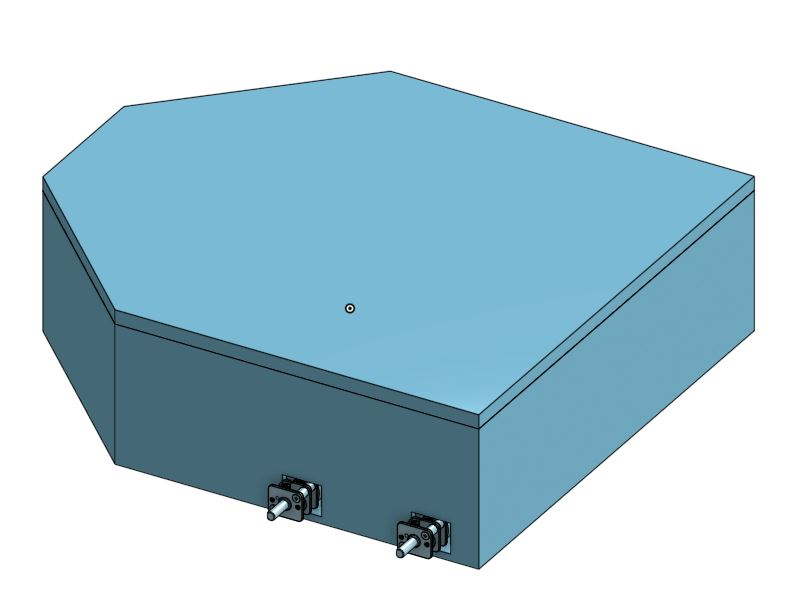

# Autonomous Line Following Robot

I designed a LFR from scratch including the PCBs for main board and a custom sensor array.

||||
| :---: | :---: | :---: |
|  |  |  |

# Components

I've decided the components based on affordability, speed, availability and ease of use.
Starting with the micro controller I've selected **STM 32 BlackPill** and for motors I've selected **3000rpm 6v N20 motors with encoders** for fast speed  to drive these motors I've chosen **TB6612FNG motor driver** because it has low voltage drop and also it is way lighter than L298N. I've decided to use a 2S Li-Po battery which is about 7.4v which can power the motors with ease and to power STM32 I'd use a step down buck converter to convert these 7.4v into 5v so we don't damage the STM32 to charge the battery I'd use a 2S charger and for the sensors I've designed a custom sensor array.

##  PCB and Connections

To talk about the connections, I'd Start with the Power connections. The battery provides 7.4v which goes to VMOT pin of motor driver and buck converter. the buck converter then outputs 5v which goes to VSYS on Pico. Now we have 3 voltages. i.e. 7.4v, 5v and 3.3v. now the 3.3v goes to VCC and STBY pin of TB6612FNG and VCC pin on Sensor Array. 
Now lets talk about the Data and Logic Signals. The GPIO pins from 0 to 18 will be connected to sensor array and GPIO pins 19,20, 21, 22, 26, 27 will be connected to PWMA, AIN1, AIN2, PWMB, BIN1 and BIN2 respectively.
At the end the AO1,  AO2 and BO1, BO2 will be connected to left and right motors respectively.
[]

|Schematics|Tracks|
| :---: | :---: |
|  |  |

## Custom Built Sensor Array

I designed the schematics for the sensor array, it is the working principle is inspired from the QTR-16RC sensor array.

|Schematics|Tracks|
| :---: | :---: |
|  |  |

# Assembling Instructions

After getting the parts and 3d Prints and PCBs

1. Solder the Parts onto PCBs
2. take M3 Screws and attach the sensor array to the front of the chasis.
3. Place the Cell Holder in designated spot and screw it in Place.
4. Take the PCB support plate and place it above the Cell Holder, then place the Main PCB on top of the plate and screw both together on the support rods.
5. Screw the Motors and caster wheels in Place.
6. Connect the motors and sensor array to the main PCB.
7. Flash the code to STM32.
8. LFR is Ready.

# Bill of Materials (BOM)

| Name | Purpose | Quantity | Total Cost (USD) | Link | Distributor |
| --- | --- | --- | --- | --- | --- |
| PCB | PCB | 2 | 17 | https://cart.jlcpcb.com/shopcart/cart/ | JLCPCB |
| Mounting Brackets | Mounting motors | 1 | 3 | https://a.aliexpress.com/_c41oltrB | AliExpress |
| N20 Wheels | Wheels for Motors | 4 | 10 | https://a.aliexpress.com/_c3mDdjNx | Ali Express |
| Caster Wheels | Caster wheels | 2 | 4 | https://a.aliexpress.com/_c2yFCmMd | AliExpress |
| Slide Switch | Power Switch | 1 | 2 | https://a.aliexpress.com/_c3g6KmzX | AliExpress |
| TB6612FNG | Motor Driver | 1 | 4 | https://a.aliexpress.com/_c3bzgEgz | AliExpress |
| N20 Motors | Motors with Encoders | 4 | 25 | https://a.aliexpress.com/_c39Rykzn | AliExpress |
| Capacitor | Capacitance | 1 | 3 | https://a.aliexpress.com/_c3Ig4r1X | Aliexpress |
| Resistors | Resistance | 2 | 5 | https://a.aliexpress.com/_c3G1MsVL | Aliexpress |
| Limit switch | Bump sensor | 1 | 2.5 | https://a.aliexpress.com/_c3uz2Isv | Aliexpress |
| Ultrasonic sensor | Measures distance | 1 | 6 | https://a.aliexpress.com/_c35Zat1R | Aliexpress |
| TCRT5000 | Sensor | 1 | 7 | https://a.aliexpress.com/_c3RbgmiN | Aliexpress |
| Header pins | Soldering on pcb | 2 | 4 | https://a.aliexpress.com/_c4B0APx7 | Aliexpress |
| Mp1584 | Buck converter | 1 | 4.5 | https://a.aliexpress.com/_c4qnSguh | Aliexpress |
| Charging module | For charging battery | 1 | 2 | https://a.aliexpress.com/_c3Dtj3BL | Aliexpress |
| STM32 | Microcontroller | 1 | 6 | https://a.aliexpress.com/_c3GJD5FF | Aliexpress |
| Soldering Iron | For Soldering | 1 | 15 | https://epro.pk/product/soldering-iron-station-adjustable-temperature-esd-safe-kada-936-in-pakistan/ | Epro |
| Customs | - | - | 60 | - | AliExpress |
| Shipping | - | - | 19 | - | JLCPCB |
